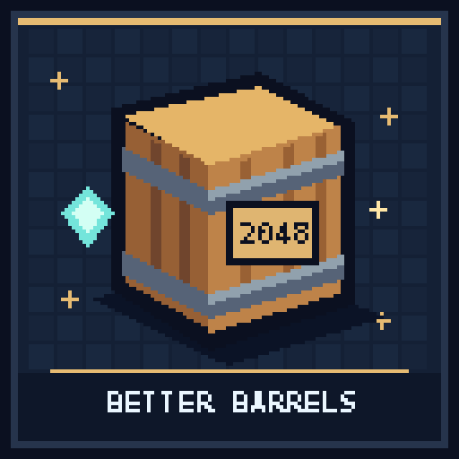

# BetterBarrels



UI-free bulk barrels for **Paper 26.3 / Java 25**, inspired by classic
single-item storage barrels. No client mod or resource pack required.

## Storage and controls

Each placed barrel holds **2,048 items of exactly one type**. Matching includes
names, lore, enchantments, container contents, and other item data, not just
the material. Emptying it completely lets you choose another type.

Use your **main hand**:

| Action | Result |
| --- | --- |
| Right-click holding an item | Store one |
| Sneak-right-click holding items | Store the held stack, up to remaining capacity |
| Right-click with an empty hand | Retrieve one |
| Sneak-right-click with an empty hand | Retrieve up to one normal stack |

A stack means the item's actual stack limit: 64 for most blocks, 16 for ender
pearls, or 1 for unstackable tools. The 2,048-item capacity applies to all.
Your action bar shows the stored item and count after interaction.

There is no inventory UI. Hoppers and hopper minecarts cannot transfer items
to/from barrels. Nonempty barrels cannot be broken, even in creative mode:
empty them first. Barrels are protected from explosions and fire. Empty
barrels can be broken normally. Pistons cannot move vanilla barrel blocks.
Protection plugins can deny interactions using the normal interaction event.
Vanilla locked barrels cannot be used until an administrator unlocks them.

Data lives in the barrel block's persistent data container and is saved with
the world, rather than an in-memory-only item counter.

## First installation

**Back up every world before installation.**

1. Build or download the JAR, place it in `plugins`, and restart Paper.
2. A background migration scans every generated chunk in all currently loaded
   Bukkit worlds, including unloaded chunks in those worlds.
3. Any barrel with vanilla inventory contents becomes a **single chest**
   containing those items. Mixed-item barrels are preserved, not discarded
   or squeezed into single-item storage. Names and vanilla locks are retained.
4. Empty barrels stay barrels and become bulk storage.

Migration checks already-loaded chunks gradually and also handles newly loaded
chunks and placed barrels. Until a legacy barrel is visited, clicking it
converts it rather than opening a UI; click the new chest again to open it.
Unexpected vanilla inventory contents inserted by another plugin are preserved
by the same chest conversion.

### Scan behavior

The scanner reads Anvil region headers and visits only allocated/generated
chunks; it never requests terrain generation. It processes at most one queued
chunk every **5 server ticks** (about four per second at 20 TPS), releases
temporary chunk tickets, and requests unloading for chunks it loaded.

Progress is checkpointed after world saves every 128 visited chunks in a region
and at region completion. After a crash, some chunks may be safely revisited.
Scan completion also saves the worlds. Do not run other world editors,
restore region files, or unload worlds during migration. Large worlds can take
hours; loading/saving chunks can still cause some tick-time spikes.

The scope is **all worlds loaded in Bukkit**, including their unloaded chunks,
not arbitrary world backups or unloaded worlds belonging to a multiworld plugin.
Load those worlds before starting an uninstall scan. World-load events enroll
additional worlds and revoke completion until their scan finishes.
Use `/betterbarrels rescan` after adding/restoring world data.

## Safe uninstall

Commands require `betterbarrels.admin` (operators by default).

- `/betterbarrels status`: mode, progress, completion or a visible failure.
- `/betterbarrels uninstall confirm`: save permanent uninstall mode and start
  a fresh full scan. **All placed barrels, including empty ones, become chests.**
- `/betterbarrels rescan`: restart a full scan without leaving uninstall mode.

Uninstall mode survives restarts and remains active even after completion, so
new barrels also become chests. It is intentionally irreversible through
commands. Keep the plugin installed while the scan runs.

**If a chest cannot fit all the items, overflow is dropped nearby as ordinary
item stacks.** A full barrel of 64-stackable items fills the chest with 1,728
items and drops the remaining 320. Unstackable items can create many drops.
Drops can despawn, burn, or be collected by mobs/players/hoppers: collect them
promptly. Conversion in an unloaded area can leave drops saved in that chunk;
visit converted areas to collect overflow before relying on it remaining there.
Choose a maintenance window with players offline or supervised.

1. Back up the worlds and load all worlds that may contain barrels.
2. Run `/betterbarrels uninstall confirm`.
3. Wait for `/betterbarrels status` to report **UNINSTALL / COMPLETE**.
   Any **PAUSED** error means **do not uninstall**; fix it and rescan.
4. Collect overflow drops, then stop Paper normally.
5. Remove the plugin JAR. Keep your backups and plugin data until verified.

Removing the JAR without this conversion does **not** restore the virtual items
to the vanilla barrel inventory. They remain in block data and are not visible
to vanilla Minecraft.

### Recovery snapshots

Before converting a nonempty barrel, the plugin writes and flushes a unique
snapshot under `plugins/betterbarrels/conversion-backups/<world-uuid>/`.
Each file starts with a version header followed by Base64-encoded Paper
`ItemStack.serializeAsBytes()` records, one stack per line. Coordinates are in
the filename. Snapshots include both virtual stock and vanilla inventory items.
They are never silently overwritten or automatically replayed (which could
duplicate items already saved in a chest). An administrator/developer can
decode these with Paper's `ItemStack.deserializeBytes()` for manual recovery.
Preserve this directory along with world backups.

Conversions deliberately bypass region building restrictions as an
administrator-authorized data migration. Direct block changes from commands,
world editors, other plugins, rollback systems, or restoring old world files
are outside normal interaction protections. Back up and test compatibility.
Like vanilla inventories, a process/power failure between ordinary saves can
roll back recent transfers; this is not a transactional database.

## Build and publish

```sh
./gradlew build --console=plain
```

Install `build/libs/betterbarrels-0.1.0.jar`. Restart Paper rather than hot-reload.
There are no runtime dependencies.

The publication targets [rewrite123/betterbarrels](https://hangar.papermc.io/rewrite123/betterbarrels),
Release channel, Paper 26.3. Provide `HANGAR_API_TOKEN` with `create_version`;
never commit credentials:

```sh
./gradlew build publishPluginPublicationToHangar --console=plain
```

Set an unused version and `-PhangarChangelog="..."` for future releases.
Normal builds do not publish or migrate any live server.

Tests cover transfer limits, metadata matching, persistence, legacy conversion,
overflow accounting, interaction protections, generated-chunk discovery,
saved cursors, and failure-paused uninstall status. The MockBukkit harness
targets 26.2 while production compiles against 26.3.

The Hangar overview is maintained in [assets/hangar-description.md](assets/hangar-description.md).
Regenerate the original icon from the repository root with
`python3 tools/generate-project-icons.py --project betterbarrels`.
