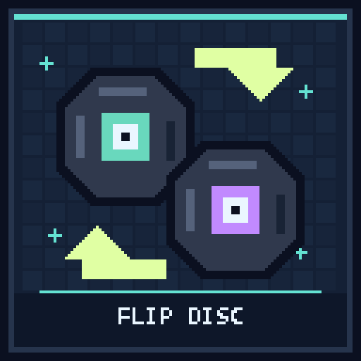

# FlipDisc



Flip a music disc over to play its other song! For **Paper 26.3 / Java 25**.
No resource pack, client mod, or bundled audio is needed.

## Usage

Place **one eligible disc, with nothing else**, anywhere in your inventory's
2 x 2 crafting grid or a crafting table's 3 x 3 grid. Take the result to flip it.
Put it back into the grid to flip it back.

Every disc type has exactly one fixed opposite. There is no randomness and no
chain of flips that can turn a disc into every song. The output is a normal
vanilla disc for the other song, so jukeboxes play it without special handling.
Removing the plugin leaves the currently selected song playable.

Normal crafting handles consumption, shift-clicks, and full inventories.
Each craft consumes one disc and produces one disc. Renames, lore, and custom
item data are preserved using Paper's item-type conversion API. Discs with an
overridden jukebox-playback component (including custom songs) are not flipped.
Automated crafter blocks cannot perform these manual flipping recipes.

## Permanent pairs

| Side A | Artist | Side B | Artist |
| --- | --- | --- | --- |
| Cat | C418 | Tears | Amos Roddy |
| Blocks | C418 | Lava Chicken | Hyper Potions |
| Chirp | C418 | Bounce | Fingerspit |
| 13 | C418 | Mellohi | C418 |
| Far | C418 | Strad | C418 |
| Mall | C418 | Stal | C418 |
| Wait | C418 | Ward | C418 |

Different artists are paired wherever possible. Most eligible songs are by
C418, so the remaining pairs necessarily share an artist.

**Single-sided:** Pigstep, Otherside, 5, Relic, Creator, Creator (Music Box),
Precipice, and 11. These have no flipping recipe. Disc 11 is the unpaired
ordinary disc because there is an odd number of eligible discs.
New discs added by future Minecraft versions are not automatically paired.

Artist references: [Tears](https://minecraft.wiki/w/Music_Disc_Tears),
[Lava Chicken](https://minecraft.wiki/w/Music_Disc_Lava_Chicken),
[Bounce](https://minecraft.wiki/w/Music_Disc_Bounce).
The plugin only selects existing vanilla songs; it does not distribute music.

## Build and install

```sh
./gradlew build --console=plain
```

The wrapper downloads a Java 25 build toolchain if needed.
Copy `build/libs/flipdisc-0.1.0.jar` into the server's `plugins` directory and
restart Paper. Stop the server before removing the plugin; avoid hot-reloading.

There are no commands, permissions, configuration files, or runtime dependencies.
Recipes appear in the recipe book for players when they join.

Tests cover pair symmetry/exclusions, both crafting grid sizes, one-disc input,
metadata-preserving conversion, custom-song rejection, preview validation,
cancelled crafting, and automated-crafter prevention. These are mocked Paper
unit tests, not an in-game test of the crafting engine.

## Publish to Hangar

The publication targets [rewrite123/flipdisc](https://hangar.papermc.io/rewrite123/flipdisc),
the `Release` channel, and Paper `26.3`. Create the Hangar project first and
provide a token with `create_version` permission through `HANGAR_API_TOKEN`.
Never commit credentials.

```sh
./gradlew build publishPluginPublicationToHangar --console=plain
```

For later releases, set an unused version in `gradle.properties` and supply
release notes with `-PhangarChangelog="..."`. Normal builds do not publish.

The public overview is maintained in [assets/hangar-description.md](assets/hangar-description.md).
Regenerate the original 512 x 512 icon from the repository root with
`python3 tools/generate-project-icons.py --project flipdisc`. This does not upload it.
