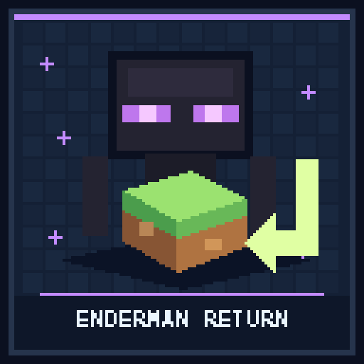

# Reduce Enderman World Damage



A standalone plugin for **Paper 26.3** and **Java 25**.

Endermen still pick up blocks normally. After each successful pickup, the plugin
chooses a random delay from **10 through 45 seconds**. Once the delay expires,
the Enderman walks back and replaces its block at the original position.

## What's new in 0.2.0

- **Renamed** from `reduceendermanblockdmg` to `reduceendermanworlddmg` to
  match the Hangar project. Delete the old `reduceendermanblockdmg-*.jar` when
  upgrading. Endermen already carrying blocks keep their return records.
- **Endermen no longer get stuck next to the gap.** Reach is measured from the
  Enderman's eyes instead of its feet, so gaps higher up in a wall count. Any
  visible point inside the gap counts as line of sight; before, the ray to the
  gap's center often clipped the block above it. An Enderman standing in the
  gap steps out of the way.
- **10-second return window with a nearby fallback.** See below.

## Behavior

- When the delay expires, the Enderman has **10 seconds** to walk back and put
  the block in its original position. Placement needs the gap to be within 3.5
  blocks of its eyes, with any part of the gap visible.
- If it hasn't managed within 10 seconds, it **still puts the block back as
  soon as it can**. Meanwhile it may instead place the block on a nearby spot
  (within 2 blocks horizontally, from 1 block below to 2 above its feet). It
  picks the spot closest to the original position that is empty, has a solid
  block underneath, can hold the block, is visible, and has no entity in it.
  If there is no such spot, it keeps carrying the block and tries again.
- Tracked Endermen never place stolen blocks anywhere else on their own.
- Existing blocks and liquids are never overwritten. If the original space is
  occupied, the Enderman waits, then uses the nearby fallback.
- Killing the Enderman cancels the return. Death drops are unchanged; the
  plugin does not recreate a block after death.
- Combat and disabled AI pause returns. The plugin never teleports Endermen or
  loads chunks. If the original chunk is unloaded, the Enderman uses the nearby
  fallback after the window.
- The plugin respects `mobGriefing` and fires a cancellable
  `EntityChangeBlockEvent` before every placement, including fallbacks, so
  protection plugins can veto it. A cancelled placement is retried, or the
  next fallback spot is tried.
- The origin and deadline are saved on the Enderman's persistent data container
  and restored when the entity loads, including after a normal server restart.
  Endermen already carrying blocks before installation are unchanged because
  their original pickup location is unknown.

The timer uses wall-clock time and is checked every 5 server ticks. Unloaded
time counts toward the delay. The 10-second window starts when the return
begins and restarts if the Enderman is reloaded.

There are no commands, permissions, or configuration files.

## Build and install

```sh
./gradlew build
```

Copy `build/libs/reduceendermanworlddmg-0.2.0.jar` into the server's `plugins/`
directory and restart Paper. Back up your world before installing new plugins.

Unit tests cover return deadlines, movement, reach and line of sight into wall
gaps, the 10-second window and nearby fallback, empty-only placement,
protection cancellation, death, carried-block changes, persistent state
recovery, and migration from the old plugin name.

## Publish to Hangar

The publication targets
[rewrite123/reduceendermanworlddmg](https://hangar.papermc.io/rewrite123/reduceendermanworlddmg),
the `Release` channel, and Paper `26.3`.

Create the Hangar project first and supply a token with `create_version`
permission through `HANGAR_API_TOKEN`. Never commit credentials.

```sh
./gradlew build publishPluginPublicationToHangar syncAllPluginPublicationPagesToHangar --console=plain
```

For later releases, set an unused version in `gradle.properties` and supply
release notes with `-PhangarChangelog="..."`. Normal builds do not publish.

The Hangar project page is synced from [assets/hangar-description.md](assets/hangar-description.md).
Regenerate the original 512 x 512 project icon from the repository root with
`python3 tools/generate-project-icons.py --project reduceendermanworlddmg`.
Generating the icon does not upload it.
